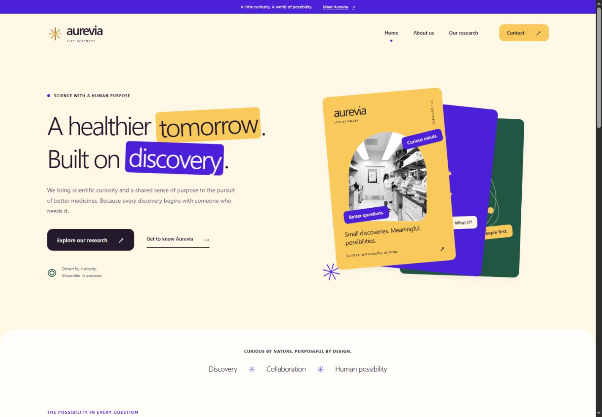

# Aurevia Life Sciences — WordPress concept

A self-directed portfolio project by **Quang Ho** for a fictional pharmaceutical / life-sciences company. An original responsive WordPress theme, four editable pages and a demonstration enquiry inbox. It is not a commissioned pharmaceutical project or evidence of a production deployment.



## Theme 1.1.0 — visual redesign

All four pages now share a warm cream canvas, vivid purple, yellow and green accents, highlighted typography, tilted editorial posters, rounded cards and redesigned navigation, CTA, form and footer. Stored page content and the existing enquiry workflow are preserved. Title highlights are applied only when rendering.

Already installed? Upload **aurevia-theme.zip** under **Appearance → Themes → Add New → Upload Theme** and replace the installed Aurevia theme. Alternatively, back up and replace only **wp-content/themes/aurevia**. Keep wp-config.php, your database, uploads and the mu-plugin. Do not rerun setup or reseed your pages. Hard-refresh the frontend if CSS is cached. Use the complete XAMPP bundle for a fresh installation.

Previews: [About](docs/about-desktop.jpg), [Research](docs/research-desktop.jpg), [Contact](docs/contact-desktop.jpg), [Mobile](docs/home-mobile.jpg).

## Quick start: XAMPP bundle

1. Download **aurevia-xampp.zip** and extract **aurevia-demo** into **C:\xampp\htdocs\**.
2. Start **Apache** and **MySQL** in XAMPP.
3. Open **http://localhost/aurevia-demo/setup.php**. Include Apache's port if necessary, e.g. **http://localhost:8080/aurevia-demo/setup.php**.
4. Enter your local database details. A default XAMPP installation commonly uses **127.0.0.1**, port **3306**, user **root** and an empty database password. Choose a **new or empty database**; existing tables are never overwritten.
5. Choose your own administrator username, email and password of at least 12 characters. Complete setup and open the site.

Admin: **http://localhost/aurevia-demo/wp-admin/**. No default administrator credentials are included. PHP **8.1+**, mysqli, mbstring and json are required, together with a WordPress-compatible MySQL/MariaDB. XAMPP itself is not included. No npm, Composer, SQL import, paid plugin or external account is needed. All frontend assets work offline after installation.

The installer accepts loopback requests only. It writes unique salts and local configuration, invokes WordPress's installer, activates Aurevia and creates four pages. It refuses to overwrite a configuration or use a database with existing tables. You can delete setup.php after installation.

## Experience

- **Home:** editorial hero, purpose, principles, research areas and contact CTA.
- **About:** company narrative, laboratory imagery, values and approach.
- **Research:** three illustrative areas, category filters, expandable focus details, process and FAQ.
- **Contact:** validated local enquiry form with consent and an administrator-only inbox.

The fictional brand does not represent clinical programs, approved products or medical advice. Sample imagery is illustrative, not a photograph of an actual Aurevia facility. No real client or patient information is included.

## Editing and inbox

Open **Pages → Edit**. The built-in classic editor controls the introductory hero paragraph. **Aurevia — Page sections** below it controls the remaining main copy. Use real line breaks in headings. Update the page and refresh the frontend. Fixed labels, branding and layout can be changed in theme source.

Send a sample message, then open **Demo enquiries** in WordPress. Records are private and visible to administrators. **No email is sent**. Use sample information only; do not submit health or sensitive personal data. Delete records through **Move to Trash → Empty Trash**. Server validation, a nonce, a honeypot and a one-minute per-address hashed rate key support the demo flow; these are not a production anti-spam service.

**Tools → Aurevia demo** creates missing sample pages while preserving existing demo page content. It also sets Home as the front page and selects plain permalinks for XAMPP compatibility. This is not a full data reset.

## Repository and packaging

Repository: **https://github.com/anhquangho/aurevia-wordpress-demo**.

The repository and source archive contain only the custom theme, must-use enquiry plugin, local installer, documentation, image assets and packaging script. WordPress core, generated configuration, database exports and user data are excluded. See [.gitignore](.gitignore). Put the full XAMPP ZIP in a GitHub Release; do not commit an installed site.

From the source folder on Windows:

```powershell
powershell -ExecutionPolicy Bypass -File .\scripts\package.ps1
```

The script downloads pinned **WordPress 7.1.4**, validates its recorded SHA256 and creates **dist\aurevia-xampp.zip**. Supply `-CoreArchive` for an already downloaded archive, or `-OutputDirectory` for a different output folder. Existing release archives are not overwritten. Staging directories are retained for inspection. The recorded archive hash is an integrity check, not a publisher signature.

For an existing **dedicated demo** WordPress installation, copy the theme and mu-plugin into wp-content, activate Aurevia, then use **Tools → Aurevia demo**. The theme refuses to take over unrelated pages using its required slugs.

There is no SQL dump: fresh setup generates portable pages and user-chosen credentials instead of shipping stale URLs or account hashes. To relocate a clean demo, install the clean bundle again. To migrate an edited installation, back up the database and wp-content, update WP_HOME/WP_SITEURL and use a WordPress-aware serialized-data search/replace tool when needed.

If setup is interrupted after wp-config.php is written, it stays locked. Preserve the logs, extract a fresh copy into a different folder and use a fresh database. Never delete another project's database. If ports or folders change, update WP_HOME and WP_SITEURL in wp-config.php. The longer Vietnamese [README](README.md) includes a troubleshooting table.

## Scope and credits

Built with PHP, WordPress APIs, CSS and vanilla JavaScript. No page builder, paid plugins, remote fonts or frontend CDN. Uses system fonts, local photos, original SVG and CSS illustrations. Includes keyboard navigation, focus states and reduced-motion support; this is not a formal accessibility certification.

The shipped configuration is for **local demonstrations**: cron and automatic updates are disabled. Public hosting requires separate deployment work, updates, HTTPS, mail delivery, privacy configuration, backups and spam handling. No deployment or clinical/regulatory compliance claim is made.

Suggested portfolio description: **“A custom WordPress concept for a fictional life-sciences company, with responsive layouts, editable page sections, research filters and a local enquiry inbox.”**

Original code: GPL-2.0-or-later. Photos have a separate license. See [THIRD-PARTY.md](THIRD-PARTY.md), [LICENSE](LICENSE) and [VERIFICATION.md](VERIFICATION.md).
