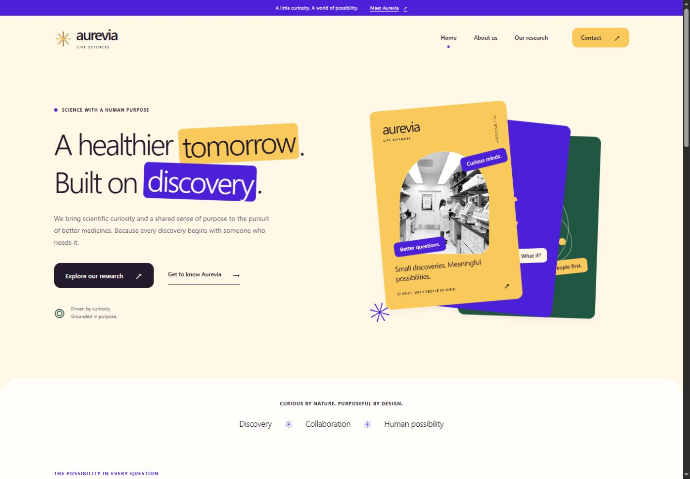

# Aurevia Life Sciences

Website WordPress 4 trang cho một công ty dược phẩm / life sciences giả lập. Portfolio concept của **Quang Ho**, tập trung vào giao diện doanh nghiệp, responsive và trải nghiệm quản trị nội dung. Đây là dự án tự xây để trình diễn, không phải website đã bàn giao cho khách hàng dược phẩm.



[English README](README.en.md) · [Giấy phép và nguồn ảnh](THIRD-PARTY.md) · [Kết quả kiểm tra](VERIFICATION.md)

## Giao diện mới — theme 1.1.0

Thiết kế lại cả 4 trang theo hướng nền kem, tím đậm, nhãn chữ vàng/tím/xanh, kiểu chữ mảnh và các tấm poster xếp nghiêng. Các trang dùng chung phong cách, bao gồm navigation, research cards, form, CTA và footer. Nội dung đã sửa trong WordPress vẫn được giữ; màu nhấn ở tiêu đề chỉ là cách hiển thị, không ghi lại nội dung database.

Xem thêm: [About](docs/about-desktop.jpg) · [Research](docs/research-desktop.jpg) · [Contact](docs/contact-desktop.jpg) · [Mobile](docs/home-mobile.jpg).

**Nếu đã cài bản cũ:** dùng **aurevia-theme.zip**, vào **Appearance → Themes → Add New → Upload Theme**, chọn ZIP và thay thế bản Aurevia đang có. Hoặc sao lưu rồi chép đè thư mục **wp-content/themes/aurevia** bằng theme mới. Giữ nguyên wp-config.php, database, uploads và mu-plugin. Không chạy lại setup.php hoặc tạo lại dữ liệu mẫu. Tải lại trang bằng Ctrl+F5 nếu trình duyệt còn giữ CSS cũ. Gói XAMPP đầy đủ dành cho cài mới; gói source dành cho GitHub.

## Chạy nhanh với XAMPP — dùng gói đầy đủ

1. Tải **aurevia-xampp.zip**, giải nén. Chép thư mục **aurevia-demo** vào **C:\xampp\htdocs\**.
2. Mở XAMPP Control Panel, bật **Apache** và **MySQL**.
3. Truy cập **http://localhost/aurevia-demo/setup.php**. Nếu Apache dùng port 8080, mở **http://localhost:8080/aurevia-demo/setup.php**.
4. Giữ database host **127.0.0.1**, user **root**, password trống nếu XAMPP của anh dùng cấu hình mặc định. Chỉnh MySQL port nếu khác 3306. Chọn tên database mới, chẳng hạn **aurevia_demo**. Database phải trống; bộ cài sẽ không ghi đè database có bảng.
5. Tự đặt username và mật khẩu WordPress (ít nhất 12 ký tự), rồi bấm **Tạo demo WordPress**. Đợi cài xong, bấm **Xem website**.

Website: **http://localhost/aurevia-demo/**. Quản trị: **http://localhost/aurevia-demo/wp-admin/**. Không có tài khoản/mật khẩu admin mặc định. Không cần terminal, Composer, npm, import SQL hay plugin trả phí. Sau lần cài đầu, các trang và tài nguyên frontend chạy offline.

Gói không bao gồm XAMPP. Cần PHP 8.1+ với mysqli, mbstring, json và MySQL/MariaDB tương thích WordPress. Bộ cài chỉ mở từ máy cục bộ qua localhost / 127.0.0.1, không qua địa chỉ LAN. Thời gian cài phụ thuộc máy và các kiểm tra nội bộ của WordPress.

## Bốn trang và thao tác demo

| Trang | Nội dung / thao tác |
| --- | --- |
| Home | Hero, giới thiệu, nguyên tắc, 3 hướng nghiên cứu, CTA |
| About us | Câu chuyện thương hiệu, ảnh phòng nghiên cứu, giá trị, cách tiếp cận |
| Our research | 3 lĩnh vực mẫu, bộ lọc, nội dung mở rộng, quy trình và FAQ |
| Contact | Form có kiểm tra dữ liệu, đồng ý lưu demo và hộp thư trong admin |

Navigation mobile đóng/mở, đóng bằng Escape; research filter thông báo số kết quả; FAQ và thông tin nghiên cứu mở bằng bàn phím. Có skip link, trạng thái focus và hỗ trợ reduced motion. Toàn bộ ảnh, CSS, JavaScript và biểu tượng nằm trong gói; font lấy từ máy, không gọi Google Fonts/CDN.

## Sửa nội dung và xem lời nhắn

- Vào **Pages → All Pages → Home / About / Research / Contact → Edit**.
- Phần soạn thảo chính sửa đoạn giới thiệu ở hero. WordPress dùng trình soạn thảo cổ điển có sẵn cho 4 trang demo, không cần cài plugin Classic Editor.
- Cuộn đến **Aurevia — Page sections** để sửa tiêu đề và các đoạn nội dung. Dùng xuống dòng trong tiêu đề để điều khiển cách ngắt dòng. Bấm **Update**, rồi tải lại trang frontend.
- Đổi tên trang ở ô Title sẽ thay đổi tiêu đề tài liệu trình duyệt; tiêu đề hero nằm trong trường **Hero title**. Một số nhãn giao diện, logo và cấu trúc là thành phần của theme, chỉnh trong mã nguồn.
- Form Contact **lưu vào database**, không gửi email. Mở **Demo enquiries → một lời nhắn** để xem tên, email, tổ chức, chủ đề, nội dung và xác nhận đồng ý. Chỉ administrator có quyền xem hộp thư. Dùng dữ liệu mẫu; không nhập dữ liệu khách hàng hay thông tin sức khỏe.
- Muốn xóa lời nhắn: **Move to Trash → Trash → Empty Trash**. Không có hệ thống gửi email / SMTP hay dịch vụ bên ngoài được cấu hình sẵn.
- **Tools → Aurevia demo → Create missing demo pages** chỉ bổ sung trang còn thiếu và giữ nội dung trang demo đã có; cũng đặt lại Home làm trang chủ và chọn plain permalinks. Không phải nút xóa dữ liệu hoặc reset nội dung.

## Database và tính di động

Không phân phối SQL dump vì dump sẽ mang theo URL cũ, tài khoản và dữ liệu phát sinh. **setup.php** tạo cấu hình với salt ngẫu nhiên, gọi installer của WordPress, kích hoạt theme và seed 4 trang. ID/URL của các trang được tra từ WordPress; không hardcode ID hoặc localhost trong theme. Plain permalinks (`?page_id=...`) giúp chạy khi Apache chưa bật rewrite.

Có thể xóa **setup.php** sau cài đặt. Bộ cài tự khóa khi có wp-config.php hoặc .aurevia-installed. Mỗi máy tự tạo tài khoản và database riêng. Để di chuyển **mã demo sạch**, giải nén lại gói ở thư mục mới và chạy bộ cài; không chép wp-config.php hoặc database cũ. Để di chuyển **bản đã sửa**, sao lưu database và wp-content, cập nhật WP_HOME/WP_SITEURL trong wp-config.php, rồi search-replace URL bằng công cụ WordPress hỗ trợ serialized data. Không thay URL hàng loạt bằng SQL REPLACE.

## Mã nguồn đưa lên GitHub

Repository: **https://github.com/anhquangho/aurevia-wordpress-demo**.

**aurevia-source.zip** chứa phần do dự án sở hữu, README, ảnh preview, giấy phép và script đóng gói. Có thể clone repository này để tiếp tục phát triển hoặc dùng source ZIP. Repository chỉ chứa mã nguồn demo; gói WordPress đầy đủ được tạo riêng bằng script đóng gói.

```text
wp-content/
  themes/aurevia/
    assets/             # CSS, vanilla JS, ảnh cục bộ, SVG gốc
    inc/content.php     # Nội dung seed
    template-parts/     # Contact form
    functions.php       # Theme setup, SEO cơ bản, page fields, seed
    header.php, page.php, footer.php, index.php, 404.php, style.css
  mu-plugins/aurevia-demo.php  # Inbox riêng tư và xử lý form
scripts/package.ps1     # Đóng gói WordPress core chính thức + source
docs/home-desktop.jpg
setup.php
README.md, README.en.md, THIRD-PARTY.md, VERIFICATION.md, LICENSE
.gitignore
```

Không commit wp-config.php, database dumps, dữ liệu form, thư mục uploads, core WordPress, file log hoặc bản build. File .gitignore đã loại các mục này. Nên đăng **aurevia-xampp.zip** dưới GitHub Releases thay vì commit WordPress core vào repository. Chỉ đăng gói sạch chưa chạy setup.

Tạo lại gói đầy đủ từ source trên Windows PowerShell (cần Internet lần đầu):

```powershell
powershell -ExecutionPolicy Bypass -File .\scripts\package.ps1
```

Script tải WordPress **7.1.4** từ wordpress.org, đối chiếu SHA256 đã ghim, rồi tạo **dist\aurevia-xampp.zip**. Có thể truyền `-CoreArchive C:\downloads\wordpress-7.1.4.zip` để dùng file đã có; checksum vẫn được kiểm tra. Script giữ thư mục staging để kiểm tra và không ghi đè archive đã tồn tại. Muốn build lại, truyền `-OutputDirectory .\dist-next`. Đây là checksum của archive đã sử dụng, không phải chữ ký phát hành. Xem nguồn chính thức trong THIRD-PARTY.md khi nâng phiên bản.

## Cài vào WordPress đã có — phương án thủ công

Chỉ dùng một WordPress demo riêng để không thay đổi trang chủ của website khác:

1. Cài WordPress theo trình cài chuẩn, trên database trống riêng.
2. Chép **wp-content/themes/aurevia** vào themes và **wp-content/mu-plugins/aurevia-demo.php** vào mu-plugins (tạo thư mục nếu chưa có).
3. Vào **Appearance → Themes → Aurevia → Activate**.
4. Vào **Tools → Aurevia demo → Create missing demo pages**.

Nếu đã có trang khác dùng slug home/about/research/contact, bộ seed từ chối dùng trang đó. Đổi slug của trang không liên quan hoặc dùng một bản WordPress demo mới.

## Khôi phục và lỗi thường gặp

| Hiện tượng | Cách xử lý |
| --- | --- |
| Apache/MySQL không Start | Xem XAMPP log và kiểm tra chương trình đang dùng port 80/443/3306. Nếu đổi port, dùng đúng port trên URL / form cài. |
| Database đã có dữ liệu | Chọn một tên database mới, không xóa database của dự án khác. |
| Không kết nối được MySQL | Kiểm tra MySQL đã bật, host, port, user và mật khẩu database. |
| Thiếu core WordPress | Anh đang dùng source ZIP. Dùng gói XAMPP đầy đủ hoặc chạy script package. |
| Setup bị khóa sau lần cài dở | Giữ lại log để chẩn đoán. An toàn nhất: giải nén gói sạch vào thư mục mới, chọn database mới. Không xóa cấu hình của site đang hoạt động. |
| Chỉ thấy trang WordPress mặc định | Kiểm tra theme Aurevia đã kích hoạt; vào Tools → Aurevia demo tạo trang mẫu. |
| Quên mật khẩu admin | Không có mailbox khôi phục trong demo. Dùng công cụ quản trị WordPress hoặc cài bản demo sạch vào thư mục/database mới. |
| Chuyển folder/port rồi link sai | WP_HOME/WP_SITEURL trong wp-config.php lưu địa chỉ lúc cài. Cập nhật cả hai theo URL mới. |

## Dùng làm portfolio

Mô tả trung thực gợi ý: **“A self-directed WordPress concept for a fictional life-sciences company, with a custom responsive theme, editable page sections, research filters and a local enquiry inbox.”**

Dự án thể hiện khả năng frontend, WordPress/PHP và xử lý form trong phạm vi demo. Không có bằng chứng triển khai sản xuất, khách hàng ngành dược, chứng nhận quản lý y tế hay kiểm thử tuân thủ. Nếu đưa lên hosting thật, cần cấu hình riêng cho HTTPS, email, backup, chống spam, dữ liệu cá nhân và vận hành. Cấu hình local hiện tắt cron và automatic updater để demo offline; cần đánh giá lại trước khi public.
